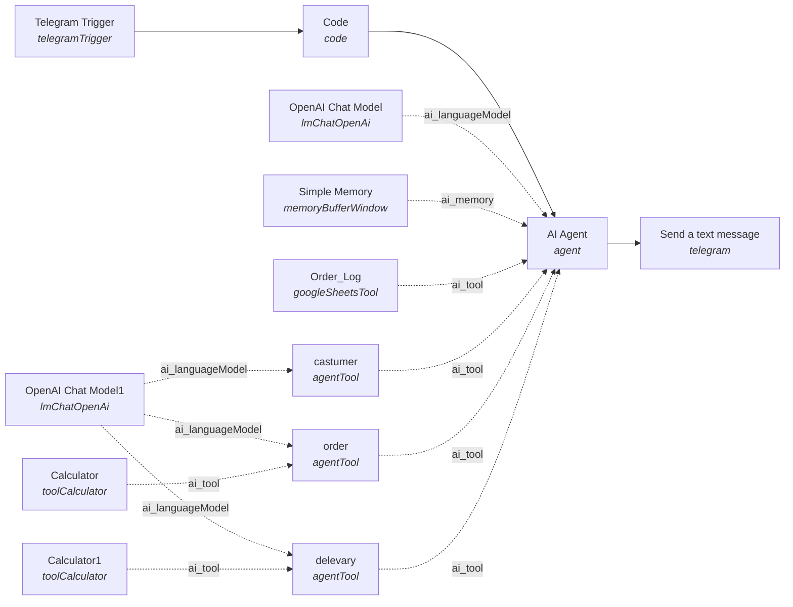
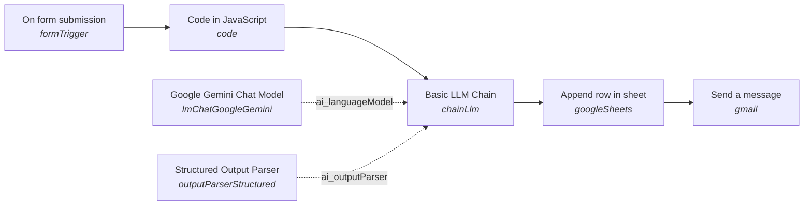
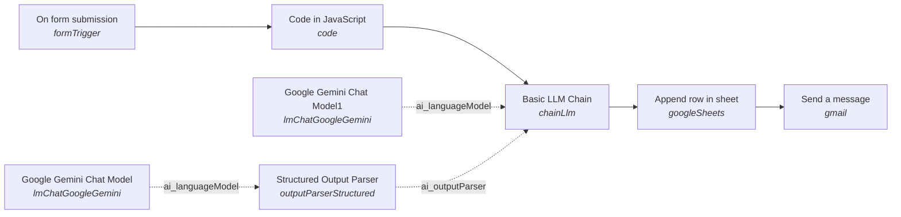
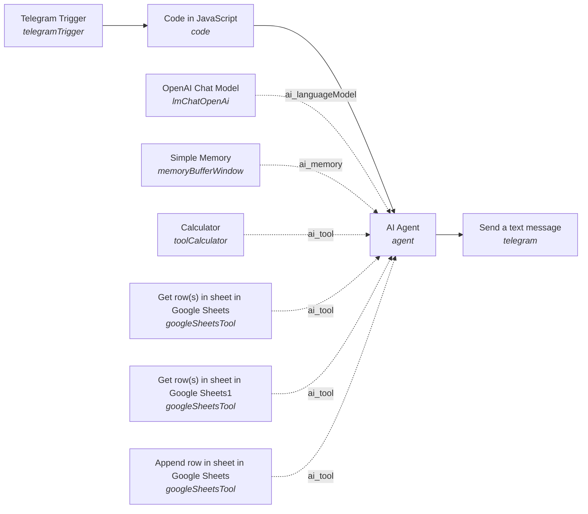

# LLM Orchestration Workflows in n8n: Structured Extraction, Tool-Using Agents and Validation

*Independent portfolio project; not affiliated with or endorsed by OIST.*

## Abstract

This repository contains four n8n workflows that orchestrate large language models over semi-structured input, plus three small exploratory files. They are practical automation systems (restaurant ordering, customer feedback, lead qualification). They were not built as research; this README analyses them for what they show about three patterns: (1) an LLM chain constrained by a structured output parser, (2) a single agent with spreadsheet-backed retrieval and logging tools, and (3) a supervisor agent that delegates to sub-agents exposed as tools. The same patterns apply to routine research-support work such as turning free-text notes into typed records, logging experiment metadata, and validating entries before they reach a dataset. No workflow here has been evaluated quantitatively, and the README makes no accuracy or deployment claims. Agent prompts are written in Arabic.

## Technical Architecture

File names below refer to the sanitised copies in [`workflows/`](workflows/).

### Gemini integration

Two of the seven published files use Google Gemini, both through the `lmChatGoogleGemini` node attached to a `chainLlm` (Basic LLM Chain) node:

| File | Gemini nodes | Model set in the JSON |
| --- | --- | --- |
| `feedback_analyzer_gemini.json` | 1 (language model of the chain) | `models/gemini-1.5-flash` |
| `feedback_analyzer_autofix_variant.json` | 2 (one for the chain, one for the parser's auto-fix step) | none; `options` is empty, so the node's default model applies |

The two agent workflows use OpenAI models, not Gemini (see below).

### Custom JavaScript

Four Code nodes contain hand-written logic. All of it is input normalisation or light validation ahead of the LLM call.

`feedback_analyzer_gemini.json` coerces the rating to an integer, rejects out-of-range values, derives a word count and a timestamp, and renames the form labels to stable keys:

```js
const rating = parseInt($input.item.json['Rating']);
if (rating < 1 || rating > 5) {
  throw new Error('Rating must be between 1 and 5');
}
const wordCount = feedback.trim().split(/\s+/).filter(word => word.length > 0).length;
return [{ json: { customerName, email, rating, feedback, wordCount, timestamp: new Date().toISOString() } }];
```

`feedback_analyzer_autofix_variant.json` applies the same range check and word count in place (`item.json.wordCount = wordCount`), without type coercion. Its comments and error message are in Arabic.

`restaurant_ordering_multi_agent.json` flattens the Telegram update into four fields with null-safe defaults: `chatId`, `userMessage`, `customerFirstName`, `timestamp`.

`lead_qualification_agent.json` maps the Telegram update to `prompt`, `sessionId` (the chat id), `firstName` and `username`. It has no guard for non-text messages.

Two caveats are visible in the code. The range check does not catch a non-numeric rating, because `parseInt` returns `NaN` and both comparisons are then false. And in both feedback workflows the derived `wordCount` (and `timestamp`) is not mapped to a sheet column; in the Gemini version `wordCount` is passed to the prompt only.

### Structured Output Parser

Both feedback workflows attach an `outputParserStructured` node to the chain. The schema is given by example. In `feedback_analyzer_gemini.json`:

```json
{
  "sentiment": "Neutral",
  "category": "Service",
  "priority": "Medium",
  "score": 60,
  "issues": "Poor quality of customer service",
  "recommendedAction": "Conduct service excellence training for front-of-house staff to match food quality standards"
}
```

The variant uses the same six fields with type names as placeholder values (`"score": "number"`) and sets `"autoFix": true`, which routes malformed output to a second Gemini node for a repair attempt.

The parser turns a free-text model response into an object with fixed keys and inferred types, so the downstream Sheets node can address `sentiment`, `score` and the rest as fields. This makes the output machine-readable and causes the run to fail on output that cannot be parsed into the schema.

It enforces format, not correctness. A schema inferred from an example fixes field names and primitive types only. The allowed label sets (for example Positive/Negative/Neutral/Mixed) and the 0–100 score range appear in the prompt text, not in the schema, so nothing rejects an out-of-vocabulary label or a score of 140. Whether a given sentiment label is right is not checked anywhere.

### Multi-agent orchestration (the ordering system)

`restaurant_ordering_multi_agent.json` is a supervisor agent with sub-agents exposed as tools:

- **Supervisor:** an `agent` node on OpenAI `gpt-4o`. Its Arabic system prompt defines a fixed sequence: collect customer details, take the order, settle delivery, log the order, confirm.
- **Sub-agents as tools:** three `agentTool` nodes (`castumer`, `order`, `delevary`; the spellings are the node names in the file), each with its own system prompt and an English tool description that tells the supervisor when to call it. All three share one OpenAI `gpt-5-mini` model node. The supervisor passes context to them through a single `$fromAI('query', …)` string.
- **Memory:** a `memoryBufferWindow` node on the supervisor only, keyed by Telegram chat id, with a window of 20. The sub-agents have no memory node; they see only what the supervisor passes in each call.
- **Calculator tools:** the `order` and `delevary` sub-agents each have a `toolCalculator`. Their prompts instruct the model to send every sum to the calculator and not compute by hand. This moves arithmetic to a deterministic tool, but the instruction is a prompt-level rule and the workflow does not verify that the tool was called.
- **Logging tool:** `Order_Log` is a `googleSheetsTool` in append mode. Timestamp and customer name come from the Code node; the other eleven columns are filled by the model through `$fromAI(...)` parameters, all typed as strings.

`lead_qualification_agent.json` is a single-agent counterpart: one `agent` node on `gpt-5-mini` with window memory, a calculator, two read-only Sheets tools (tabs `Statics_KB` and `Dynamic_KB`) and one append tool (tab `Lead_log`). The prompt separates stable facts from changing ones (prices, seats, dates) and requires a fresh lookup for the latter.

### Diagrams

Generated from each file's `connections` object. Solid arrows are the main data path; dotted arrows are n8n AI sub-connections, labelled with the connection type.

**`restaurant_ordering_multi_agent.json`**



**`feedback_analyzer_gemini.json`** (the sticky note is unconnected and omitted)



**`feedback_analyzer_autofix_variant.json`**



**`lead_qualification_agent.json`**



## Motivation: Bridging Software Engineering and AI Research

I hold a BSc in Computer Science from Al-Balqa' Applied University (GPA 3.80/4.00). My graduation research project examined AI in defense systems. Most of my practical work has been software engineering: mobile applications in Flutter, backends in Laravel and Java Spring, and edge AI on NVIDIA Jetson hardware.

The workflows in this repository come from that engineering side. Building them showed me where LLM systems tend to break in practice: at the boundary between free text and typed data, in arithmetic the model should not be doing itself, and in records that are written without being checked. Those are the same places where research tooling needs care.

My aim is to build reliable, reproducible automation that supports AI research: data pipelines, experiment bookkeeping and validation steps that make results easier to trust and repeat. I would like to contribute that kind of engineering to interdisciplinary AI labs at OIST, and to learn the research practice that my current work does not yet include, starting with proper evaluation.

## Workflow Breakdown

| File | Nodes | Trigger | Models | Parser | Custom JS | Data-science description |
| --- | --- | --- | --- | --- | --- | --- |
| `restaurant_ordering_multi_agent.json` | 13 | Telegram message | `gpt-4o` (supervisor), `gpt-5-mini` (3 sub-agents) | N | Y | Multi-stage conversational data collection with delegated sub-tasks, tool-based arithmetic and append-only record logging (a Telegram food-ordering assistant) |
| `feedback_analyzer_gemini.json` | 8 (incl. 1 sticky note) | n8n form | `models/gemini-1.5-flash` | Y | Y | Automated qualitative data analysis and validation pipeline: input checks, LLM labelling into a fixed schema, tabular storage (customer feedback processing) |
| `feedback_analyzer_autofix_variant.json` | 8 | n8n form (n8n user auth) | Gemini, model not set in file (2 nodes) | Y, `autoFix` on | Y | The same labelling pipeline with a second-model repair step for malformed output (customer feedback processing, alternate version) |
| `lead_qualification_agent.json` | 10 | Telegram message | `gpt-5-mini` | N | Y | Retrieval-grounded slot filling: an agent answers from two tabular knowledge sources and writes a record once required fields are complete (enquiry and lead-capture assistant for a children's robotics and AI training centre) |

### `restaurant_ordering_multi_agent.json`

Workflow name in the file: "Smart Restaurant Ordering System". A Telegram message is normalised by a Code node and handed to the supervisor agent, which calls the three sub-agents and the `Order_Log` tool as described above, then replies through the Telegram node to the originating chat id. The supervisor prompt lists the fields that must be present before a row may be logged and forbids logging incomplete orders; this completeness rule lives in the prompt and is not enforced by a node. The restaurant name, menu, prices, delivery zones and address in the published copy are placeholders and sample values.

### `feedback_analyzer_gemini.json`

Workflow name in the file: "AI Restaurant Feedback Analyzer". A form collects name, email, rating and free-text feedback. The Code node validates and normalises, the chain asks Gemini for six fields, the parser types the result, a Sheets node appends the row, and a Gmail node sends a fixed thank-you message to the submitter. The LLM analysis is stored but not used in the email. The Gmail node in this file has no credential attached, and the Sheet id is the n8n builder's own placeholder, so this file needs configuration before it can run. An embedded sticky note holds a short setup guide.

### `feedback_analyzer_autofix_variant.json`

Workflow name in the file: "My workflow 3". It has the same shape as the previous workflow, with three differences: the prompt reads directly from the form trigger and asks for "only valid JSON"; the parser has `autoFix` enabled with its own Gemini node; and the Sheets node reads the parsed fields from `$json.output.<field>`, where the other version reads `$json.<field>`. The Sheets schema lists `Word Count` and `Timestamp` columns that have no mapping.

### `lead_qualification_agent.json`

Workflow name in the file: "My workflow 4". The Arabic system prompt (about 14,500 characters) covers tool selection, a no-fabrication rule, gradual collection of parent and child details, and a repeated rule that the Telegram chat id must never be recorded as a phone number. Two details in the file differ from the prompt: the prompt lists Email and Location as lead fields, but the append tool maps only eight columns without them; and the prompt says the workflow supplies the customer's name and username, while the agent node receives only the message text (`$json.prompt`).

### Other files (exploratory or incomplete)

- `other/ad_router_scaffold.json` (6 nodes, scaffold): a form with an action dropdown, a Set node that normalises fields, a Sheets append, and an IF node whose two branches end in placeholder Set nodes that say the step will be built later. No LLM.
- `other/tutorial_set_fields.json` (3 nodes, tutorial): a manual trigger and two Set nodes with sample values.
- `other/tutorial_form_code_sheet.json` (3 nodes, tutorial): a form, the default Code-node template (`item.json.myNewField = 1`), and an unconfigured "Create spreadsheet" node.

One further export, "Smart Advertiser - Router", contained zero nodes and is not included.

## Setup and Usage

No API keys, tokens, credential ids, spreadsheet ids or webhook ids are committed. The published files contain placeholders such as `<GOOGLE_SHEET_ID>` and `<CREDENTIAL_ID>` and will not run until these are replaced.

1. **Run n8n locally.**
   - npm: `npx n8n` (or `npm install -g n8n`, then `n8n start`)
   - Docker: `docker run -it --rm --name n8n -p 5678:5678 -v n8n_data:/home/node/.n8n docker.n8n.io/n8nio/n8n`

   Then open `http://localhost:5678`.
2. **Import a workflow.** Workflows → Import from File, and choose a file from `workflows/`.
3. **Create credentials** in n8n and select them on the relevant nodes:
   - Google Gemini API: both feedback workflows
   - OpenAI: both agent workflows
   - Google Sheets OAuth2: all four
   - Gmail OAuth2: both feedback workflows
   - Telegram bot (token from BotFather): both agent workflows

   In the original exports the LLM nodes used n8n-managed gateway credentials (`__aiGatewayManaged`). Replace these with your own Gemini and OpenAI credentials. The models `gpt-4o`, `gpt-5-mini` and `gemini-1.5-flash` are the names stored in the files; substitute a model your account can access if any is unavailable.
4. **Replace placeholders.** In each Google Sheets node, select your spreadsheet and tab in place of `<GOOGLE_SHEET_ID>`, `<GOOGLE_SHEET_URL>`, `<GOOGLE_SHEET_NAME>` and `<SHEET_GID>`. `<WEBHOOK_ID>` values are regenerated by n8n when you re-save the trigger node. In the ordering workflow, replace "Restaurant X", the sample menu, the sample delivery zones and the bracketed Arabic placeholders with your own content.
5. **Create the sheet columns** (row 1 headers, matching the append nodes exactly):

   | Workflow | Tab | Columns |
   | --- | --- | --- |
   | `feedback_analyzer_gemini.json` | `Sheet1` | Customer Name, Email, Rating, Feedback, Sentiment, Category, Priority, Score, Issues, Recommended Action |
   | `feedback_analyzer_autofix_variant.json` | first tab | Name, Email, Rating, Feedback, Sentiment, Category, Priority, Score, Issues, Recommended Action |
   | `restaurant_ordering_multi_agent.json` | `Order_Log` | Timestamp, Customer Name, Phone Number, Order Items, Quantity, Food Total, Delivery Fee, Total Price, Delivery/Pickup, Area, Address, Notes, Status |
   | `lead_qualification_agent.json` | `Lead_log` | timestamp, parentName, phone, childName, childAge, program, interestNeed, status |

   The lead agent also reads two tabs, `Statics_KB` and `Dynamic_KB`. Their columns are not defined in the workflow file; the agent reads whatever rows are present. The prompt expects programme descriptions and age ranges in the first, and prices, discounts, seats and schedules in the second.
6. **Activate and test.**
   - Feedback workflows: open the form URL from the Form Trigger node and submit, for example, name `Test User`, an email address you control, rating `2`, feedback `The food was good but we waited forty minutes for a table.` Check that a row is appended and the email arrives. A rating of `7` should fail at the Code node.
   - Agent workflows: send a text message to your Telegram bot (for example "I'd like to order" or "What programmes do you offer?") and follow the conversation. Check the `Order_Log` or `Lead_log` tab after a completed exchange.

## Limitations and Future Work

### Limitations

- **No evaluation set.** There are no labelled examples and no measurements of labelling agreement, extraction accuracy, tool-call reliability or cost. Nothing in this repository supports a quantitative claim.
- **LLM output is not independently verified.** The parser checks structure only. Sentiment labels, scores, logged order totals and lead fields are written as the model produced them.
- **Prompt-level rules are not enforced.** "Always use the calculator", "do not log an incomplete order" and "never store the chat id as a phone number" are instructions, with no node that checks compliance.
- **Not verified end to end for this write-up.** The descriptions come from reading the exported JSON. The two feedback workflows read the parser output at different paths (`$json.sentiment` and `$json.output.sentiment`); I have not confirmed which is correct for each chain node version.
- **Prompts untested at scale** and not tested against adversarial or off-topic input.
- **Arabic-only agent prompts.** All agent system prompts are in Arabic, with instructions to reply in the user's language. The feedback prompts are in English. Behaviour in other languages is untested.
- **Weak input validation.** Non-numeric ratings pass the range check; the lead agent's Code node assumes a text message.
- **Sub-agents are stateless.** In the ordering system only the supervisor has memory, so order state depends on what the supervisor passes on each call.
- **Sanitised copies differ from the originals.** Identifiers are placeholders, and the restaurant name, menu, prices, delivery zones and address were replaced with sample values, so the published prompts are illustrative.
- **Assisted authoring.** Three files (`restaurant_ordering_multi_agent.json`, `feedback_analyzer_gemini.json`, `other/ad_router_scaffold.json`) carry the n8n metadata flag `aiBuilderAssisted: true`.
- **Exploratory files.** The three files under `workflows/other/` are a scaffold and two tutorials and show no LLM technique.

### Future Work (not implemented)

- A held-out, human-labelled feedback set to measure agreement between parser-validated sentiment and human labels, per language.
- A strict JSON Schema with enumerated labels and a bounded score, in place of the example-derived schema, with rejected outputs logged.
- A deterministic post-check that recomputes order totals from logged items and prices and flags mismatches.
- Execution logging (prompt version, model name, inputs, outputs) so that runs can be reproduced and compared.
- English versions of the agent prompts and a small bilingual test set.
- Adapting the form-to-typed-record pattern to experiment metadata capture.
